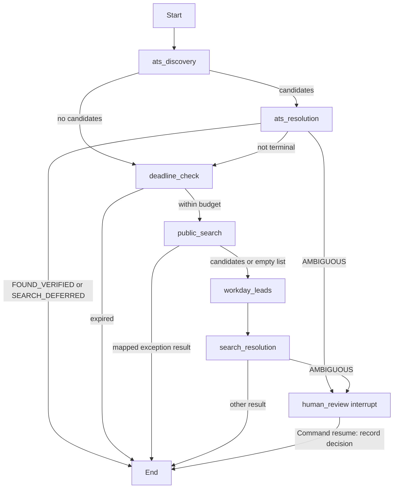

# Optional LangGraph official-job resolution

`src.agent.resolution_graph` is a new, opt-in orchestration path. The existing
`src.enrichment.official_job_resolver.resolve_official_job` remains unchanged and
remains the production path. No application caller was switched to the graph.

## Flow



| Node | Existing implementation used |
| --- | --- |
| `ats_discovery` | `official_job_resolver.discover_ats_candidates(job, client)`; same exception-to-empty handling and `ats_discovery_ms` timing |
| `ats_resolution` | `official_job_resolver.resolve_from_candidates(..., source="ats", deadline=...)` |
| `deadline_check` | The baseline resolver's inline check before public search, with the same deferred-result fields |
| `public_search` | `search_circuit.search(job, client)` when truthy; otherwise `official_job_resolver.search_candidates`; same three exception mappings |
| `workday_leads` | Baseline homepage filtering/deduplication loop and `workday.discover_from_search_homepage` |
| `search_resolution` | `official_job_resolver.resolve_from_candidates(..., source="search", deadline=...)` |
| `human_review` | New `langgraph.types.interrupt`; stores a decision without changing the resolver result |

Candidate fetching, identity validation, ranking, competing-candidate ambiguity,
and deadline checks inside candidate resolution are delegated to the existing
resolver. The graph does not implement another verification policy.

## Checkpoints and review

`ResolutionState` stores the job, monotonic deadline, candidate dictionaries,
per-node timing trace, result dictionary and optional `human_decision`.
`ResolutionContext` carries the HTTP client and search circuit only during an
invocation. Neither object is saved in checkpoints. Candidates and result
payloads are serialized as plain dictionaries; the result timestamp is ISO text.
The convenience wrapper reconstructs the existing `OfficialJobResolutionResult`,
including its description and identity-validation dataclasses.

`build_graph(checkpointer=None, *, checkpoint_path=None)` creates a `SqliteSaver`
when none is supplied. Its default file is
`<system temp>/job-resolution-graph-<unique>/checkpoints.sqlite`, outside the
repository. Close `graph.checkpointer.conn` when using this owned saver.
Alternatively, use a caller-owned saver as below. `checkpoint_path` selects an
explicit file, whose parent directory must already exist. No application DuckDB
connection is opened by the graph orchestration.

```python
from langgraph.checkpoint.sqlite import SqliteSaver
from langgraph.types import Command
from src.agent.resolution_graph import build_graph

# job and client are supplied by the caller; this is not a live-run command.
with SqliteSaver.from_conn_string("/tmp/job-resolution-review.sqlite") as saver:
    graph = build_graph(checkpointer=saver)
    config = {"configurable": {"thread_id": str(job["record_key"])}, "callbacks": []}
    context = {"client": client, "search_circuit": None}
    state = graph.invoke({"job": job, "trace": []}, config, context=context)
    if "__interrupt__" in state:
        review_payload = state["__interrupt__"][0].value
        # A human supplies "accept:<url>" or "reject" after inspecting the payload.
        state = graph.invoke(Command(resume="reject"), config, context=context)
```

The inspected baseline ambiguous fixture has status `AMBIGUOUS`, URL `None`,
source `greenhouse`, confidence `1.0`, and reason
`multiple verified official candidates were too close to choose safely`.
It contains resolved title/company/location but no description or
identity-validation object. Its `candidate_validation_trace` contains both
accepted URLs (Greenhouse `/seismic/jobs/123` and Lever `/seismic/456`), fetch
status, HTTP status, word count, resolved title/company, identity reason and
fetch timing. These usable URLs and the actual trace are presented alongside
record key, title, company and location in the interrupt. The graph does not
invent candidate descriptions or per-candidate confidence values.

The resume string is recorded as `human_decision`. An acceptance is a review
note, not new verification evidence: the result remains `AMBIGUOUS`, no URL is
promoted and no application database is written. The convenience function
`resolve_official_job_graph(job, client, search_circuit=None, checkpointer=None)`
returns this unchanged result even when review is pending. Use `build_graph`
with a known checkpoint file and explicit `Command` for pause/resume control.
Its wrapper thread ID is the record key, or a UUID when the key is absent.

Graph construction disables `LANGSMITH_TRACING`, `LANGCHAIN_TRACING_V2` and
`LANGCHAIN_TRACING` in the process environment. The wrapper also uses a disabled
tracing context and empty callbacks. No LangSmith account, API call, telemetry
exporter or additional search/scoring request is introduced.

## Equivalence verification

The new test is a `unittest.TestCase` with a `unittest.main()` entry point, and
is registered in the existing legacy inventory. Tests reuse the resolver and
ATS fixture modules, use fresh jobs/clients/circuits for each runner, and patch
the existing resolver's names. All HTTP responses are supplied by mock
transports. Parity compares every result field except the resolved timestamp,
including nested description/validation payloads, exceeding the five required
status/URL/source/confidence/reason comparisons.

| New test scenario | Outcome |
| --- | --- |
| Verified via ATS | `FOUND_VERIFIED`; no public-search stage |
| Verified via public search | `FOUND_VERIFIED` |
| Multiple verified search matches | `AMBIGUOUS`; both accepted URLs available |
| No official match | `OFFICIAL_NOT_FOUND` |
| Blocked employer posting | `BLOCKED` |
| Deferred search circuit | `SEARCH_DEFERRED` |
| Deadline expired before search | `SEARCH_DEFERRED`; exact baseline reason |
| Fetched employer identity mismatch | `OFFICIAL_NOT_FOUND`, as in the baseline |
| ATS adapter exception | Falls through to a verified public-search result |
| Workday homepage lead | Existing Workday listing discovery finds the verified posting |
| Search permission error | `BLOCKED`; same error fields |
| Unexpected search error | `ERROR`; same error fields |
| Nonmatching ATS candidates | Continues to public search |
| Ambiguous ATS candidates | Stops before public search |
| Interrupt and resume | Both accept and reject survive closing/reopening SQLite; no candidate-resolution replay; result unchanged |
| Serializable checkpoint and thread isolation | JSON-compatible state restored from SQLite for two independent threads; no client/circuit persisted |

The initial test draft made two incorrect assertions about existing behavior:
identity mismatch was expected to yield `INSUFFICIENT_IDENTITY`, and the
nonmatching ATS scenario was incorrectly expected to skip public search.
Those new-test assertions were corrected to the observed baseline behavior;
no resolver logic was changed.

| Validation | Result |
| --- | --- |
| Baseline pytest | 659 passed, 138 subtests passed |
| Baseline legacy runner | All 57 scripts passed |
| New test module | 16 passed, 2 subtests passed |
| Full normal pytest | 675 passed, 140 subtests passed (80.98 s) |
| Full reverse pytest | 675 passed, 140 subtests passed (81.67 s) |
| Collection-order check | All 675 IDs exactly reversed using the same external comparison hook as `docs/pytest_comparison.md` |
| Updated legacy runner | All 58 scripts passed |
| Compilation and diff checks | Passed |
| Fresh interpreter, graph imported first | Passed |
| Fresh interpreter, baseline resolver imported first | Passed |
| Default temporary SQLite saver smoke check | Passed |
| Installed dependency consistency (`pip check`) | Passed |

Validation used the throwaway virtualenv outside the repository, disabled dotenv
loading, and an external audit guard blocking network connections and protected
local files. No live scoring, search, enrichment or production database run was
performed. Baseline, normal/reverse pytest results, legacy logs and import
results are saved under `/tmp/langgraph-resolution/`. New dependencies are
pinned from that environment's `pip freeze`: `langgraph==1.2.16` and
`langgraph-checkpoint-sqlite==3.1.2`.

## Why a graph here

The graph provides a checkpoint at each completed stage, an explicit pause for
ambiguous review, and `trace` entries of `{node, elapsed_ms}` for orchestration
visibility. Timing uses a separate performance clock so recording node durations
does not consume the resolver's mocked monotonic-clock sequence. Existing
per-job resolver timings remain available in `job["enrichment_timing"]`.

## Limitations

- This is an opt-in experiment, with no Streamlit or production wiring.
- Human decisions are notes only; there is no promotion, persistence approval
  workflow, UI, or automatic resolution of ambiguous identity.
- The review trace has URLs and identity summaries, not complete candidate
  descriptions, per-candidate confidence or authoritative location provenance.
- JSON-like job payloads are required. Checkpoints contain job details and may
  contain fetched descriptions. Callers own file retention and cleanup; default
  temporary checkpoint files are retained for inspection.
- SQLite is intended for lightweight synchronous use. This implementation does
  not add distributed workers, asynchronous orchestration or retry policies.
- Clients and circuits must be resupplied on resume. The tested resume is the
  human-review pause after resolution. General mid-resolution restart across
  process/host changes is not promised: the saved deadline uses a process-local
  monotonic clock, and external calls are not transactional with checkpoints.
- Graph/checkpoint overhead counts against the same time budget. Outcomes near
  a real deadline can vary with runtime timing and changing external responses;
  the equivalence tests use fixed offline responses and a controlled expiry case.
- LangSmith tracing is disabled at graph construction, including its process
  environment switches. No tracing dashboard is provided.
