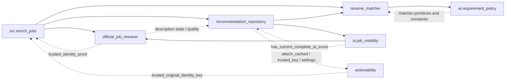

# Phase A: dependency map and proposed refactor

**Status: proposal only. Phase B has not started and requires explicit user approval of one source file.** This change adds this document only; it does not refactor application code, change tests, or change the legacy runner. Earlier pytest experiment files remain outside this Phase A scope.

## Scope and method

Inventory: static AST inspection of every Python source file under `src/`, `scripts/`, `ops/`, plus `streamlit_app.py` and root `conftest.py`. Source files were parsed, not imported for analysis. No runtime database, `.env`, or actual resume file was inspected. Function names and line numbers below describe the current working tree.

The map distinguishes named imports, imports inside functions, module-alias attribute references, and old-namespace patch targets. Imports show dependency bindings, not proof that every branch executes. Dynamic `getattr`, arbitrary import strings, out-of-repository clients, and database-defined behavior are not fully provable by this static scan. Private top-level functions are included; nested functions and class methods are excluded from the top-level function count.

| Existing module | Lines | Top-level functions | Top-level classes |
| --- | ---: | ---: | ---: |
| `src/enrich_jobs.py` | 2846 | 45 | 3 |
| `src/repositories/recommendation_repository.py` | 3516 | 47 | 4 |
| `src/ai/resume_matcher.py` | 1969 | 36 | 5 |

All **128 top-level functions** are assigned exactly once in the proposed groups below. The 12 classes and shared/imported names also need explicit owners; moving only function definitions is insufficient.

## Current dependency graph

An arrow means “imports from”. Solid edges are module-level imports; dotted edges are deferred imports inside functions.

These are real dependency cycles when deferred edges are included. They do not by themselves prove a failing import: existing offline tests load these modules successfully. Moving deferred imports to the top without changing ownership could introduce partial-initialization failures.

### Confirmed resolver back-imports

| Caller | Import site | Names | Purpose |
| --- | --- | --- | --- |
| `fetch_candidate_description` | `src/enrichment/official_job_resolver.py:596` | `MINIMUM_FULL_DESCRIPTION_WORDS`, `description_has_quality_signals` from repository | Decide whether static content needs browser fallback. |
| `validate_candidate_result` | `src/enrichment/official_job_resolver.py:672` | `trusted_identity_proof` from enrichment runner | Supply independent original/fetched key evidence to identity validation. |
| `resolve_from_candidates` | `src/enrichment/official_job_resolver.py:831` | `trusted_identity_proof` from enrichment runner | Explain rejected candidate identity without weakening acceptance. |
| `resolve_from_candidates` | `src/enrichment/official_job_resolver.py:875` | `description_state` from repository | Count recovered full descriptions for provider metrics. |

### Other back-edges that a split must preserve or deliberately remove later

- `src/ai/requirement_policy.py` imports matcher primitives inside `_aliases`, `description_requirement_clauses`, `clause_groups`, `validate_hard_gap_clause`, and `central_specialization_gaps` (lines 14, 51, 388, 402, 425, 452, 482, 684). The matcher imports policy functions at module scope around line 1325 and exposes some as existing public aliases.
- `src/ui/job_visibility.py:41` imports `has_current_complete_ai_score` inside `is_user_reviewable_job`, while the repository imports visibility helpers at module scope.
- Repository functions defer imports from `src.actionability`: `trusted_display_posting_key` imports `trusted_key`; `load_all_jobs` imports `attach_cached`, `settings`, and `now_utc`. Actionability in turn imports enrichment identity proof. Therefore display/status logic is not currently a database-only leaf.
- `src.ai.job_eligibility` imports the matcher error type and description helper; the repository imports eligibility types. A prompt-version constant alone also makes enrichment and repository import the large matcher module.

## Function inventory and proposed owners

Paths below are proposed new modules, not edits or promises that all cycles can be removed in the first one-file change. Span totals count current function bodies/signatures only; imports, types, constants, comments and blank space add to the resulting file size.

### `src/enrich_jobs.py`

| Responsibility | Proposed module | Functions (current definition line) | Function-span lines |
| --- | --- | --- | ---: |
| Schema and table discovery | `src/enrichment/storage_schema.py` | `initialize_enrichment_tables` (151), `table_exists` (397) | 168 |
| Identity proof and trusted source provenance | `src/enrichment/identity_proof.py` | `requires_identity_validation` (304), `trusted_original_identity_key` (319), `trusted_identity_proof` (336), `validate_enrichment_identity` (342), `stored_verified_key_is_trusted` (588), `_compatible_verified_key` (602), `authoritative_verified_key_for_job` (616), `stored_candidate_identity_accepted` (702), `direct_source_verified_key_source` (720), `direct_source_url_verified_key` (750), `source_result_verified_key` (777) | 278 |
| Retry/selection policy and trusted description targeting | `src/enrichment/selection_policy.py` | `as_utc_datetime` (416), `official_retry_cutoff` (431), `official_status_value` (439), `needs_official_resolution` (445), `needs_description_enrichment` (481), `trusted_known_official_description_url` (2363) | 100 |
| Known candidate matching and verification | `src/enrichment/known_candidates.py` | `find_known_official_candidates` (795), `annotate_known_official_candidates` (834), `verify_known_official_candidate` (2250) | 230 |
| Verified local reuse and queue preparation | `src/enrichment/verified_reuse.py` | `load_verified_reuse_candidates` (513), `reuse_verified_description` (918), `reuse_authoritative_verified_descriptions_before_queue` (1019), `prepare_verified_candidate_metadata_before_queue` (1094) | 284 |
| Queue SQL and ordering | `src/enrichment/queue_repository.py` | `load_jobs_to_enrich` (1135), `summarize_enrichment_queue` (1526) | 403 |
| Atomic attempt/description persistence | `src/enrichment/attempt_repository.py` | `_official_resolution_verified_key_metadata` (1732), `_direct_source_verified_key_metadata` (1761), `_accepted_result_verified_key_metadata` (1782), `verified_key_metadata_for_save` (1810), `_validate_official_identity_for_save` (1857), `save_enrichment_attempt` (1933), `description_update_is_improvement` (2186), `update_job_description` (2197) | 481 |
| Per-job processing and verified fetching | `src/enrichment/processing.py` | `existing_description_result` (2229), `fetch_verified_official_description` (2378), `process_enrichment_job` (2457) | 239 |
| Batch containment, counters, diagnostics and budgets | `src/enrichment/batch.py` | `default_enrichment_totals` (1513), `failed_processing_result` (1555), `safe_enrichment_log_message` (1580), `process_enrichment_batch` (1601) | 182 |
| CLI and console presentation | `src/enrichment/cli.py` | `print_result` (2602), `main` (2658) | 239 |

**Supporting types:** `EnrichmentProcessingResult` (122), `EnrichmentBatchSummary` (133), `KnownCandidateVerification` (145).

**Supporting ownership:** propose `src/enrichment/contracts.py` for the three result dataclasses and enrichment status/budget constants. Keep official resolver result/candidate types and statuses as the same imported objects, not copies. `create_http_client` is currently an imported public alias, not a function defined in this file; retain that alias on the old module.

**Important internal paths:** `load_jobs_to_enrich → prepare_verified_candidate_metadata_before_queue → reuse_authoritative_verified_descriptions_before_queue → reuse_verified_description → save_enrichment_attempt`. Queue preparation can write reused descriptions; it must not be relabeled a read-only repository. `process_enrichment_batch → process_enrichment_job` also reaches verified fetch, validation and persistence. Keep attempt/description transaction boundaries in `save_enrichment_attempt` intact.

**Constraint:** the proposed identity owner still depends on `is_aggregator_job` from the resolver and `extract_embedded_destination_url` from the repository. Merely moving `trusted_identity_proof` does not create an independent leaf. Later cross-file cleanup would need a shared URL/domain layer, using existing `src.job_domains` and `src.verified_posting_identity` where possible; that is not authorized in Phase B.

### `src/repositories/recommendation_repository.py`

| Responsibility | Proposed module | Functions (current definition line) | Function-span lines |
| --- | --- | --- | ---: |
| Exact posting URL identity, platform keys and trust scope | `src/repositories/posting_identity.py` | `normalize_source_name` (162), `normalize_apply_url_for_identity` (167), `is_redirect_or_tracking_url` (222), `_decode_possible_url` (244), `extract_embedded_destination_url` (254), `resolve_redirect_final_url` (280), `_extract_job_id_from_path` (315), `extract_posting_platform_identity` (320), `build_posting_identity` (368), `exact_posting_identity` (436), `register_exact_posting_identity_function` (451), `normalize_duplicate_text` (882), `verified_identity_scope` (901), `trusted_display_posting_key` (928), `_trusted_snapshot_key` (2410) | 380 |
| JSON/date row conversion and age calculations | `src/repositories/job_row_values.py` | `parse_json_list` (491), `parse_email_datetime` (506), `normalize_datetime` (521), `best_job_date` (549), `job_age_days` (560) | 79 |
| Description quality/state | `src/repositories/job_description_state.py` | `description_has_quality_signals` (614), `current_description_word_count` (619), `has_quality_description` (631), `description_state` (1328) | 37 |
| Current-score validity, fit and enrichment priority | `src/repositories/job_priority.py` | `has_current_complete_ai_score` (641), `derive_fit_priority` (672), `calculate_enrichment_priority` (746), `enrichment_waiting_days` (580) | 267 |
| Eligibility schema, persistence and admission | `src/repositories/job_eligibility_repository.py` | `initialize_job_eligibility_table` (977), `apply_admission_gate` (1346), `save_job_eligibility_decision` (1418), `load_unscreened_job_eligibility_candidates` (3144) | 570 |
| Cached profile lookup and active-resume fallback | `src/repositories/resume_profile_repository.py` | `load_latest_cached_resume_hash` (1244), `resolve_display_resume_hash` (1275), `load_resume_profile_payload` (1285) | 78 |
| Display identity and representative selection | `src/repositories/job_display.py` | `ui_duplicate_key` (950), `verified_display_representative_rank` (2230), `prepare_job_display` (2276) | 193 |
| Reviewable jobs and existing recommendation mart reads | `src/repositories/job_queries.py` | `load_all_jobs` (1479), `load_recommendations` (3435) | 831 |
| Application status writes and thin snapshot overlays | `src/repositories/application_status_repository.py` | `_status_snapshot_overlays` (2423), `update_application_status` (2484) | 96 |
| Score candidate/cache reads and counts | `src/repositories/scoring_candidates.py` | `load_candidate_jobs` (2523), `count_cached_canonical_scores` (2878), `count_unscored_candidate_jobs` (2931) | 615 |
| Reviewable and pipeline metrics | `src/repositories/pipeline_metrics.py` | `reviewable_job_metrics` (3322), `load_pipeline_operation_metrics` (3374) | 109 |

**Supporting types:** `PostingIdentity` (140), `FitPriority` (149), `EnrichmentPriority` (156), `ApplicationStatusChange` (2403).

**Supporting ownership:** `PostingIdentity` and URL/tracking constants belong with `posting_identity`; `FitPriority`, `EnrichmentPriority` and priority thresholds with `job_priority`; `ApplicationStatusChange` with the application-status owner. Preserve `MATCHER_PROMPT_VERSION`, eligibility-version defaults, SQL fragments, trusted-source sets, and public imported aliases such as `classify_job_review_bucket` and `MINIMUM_FULL_DESCRIPTION_WORDS` through the compatibility module.

**Important internal paths:** `load_all_jobs` joins persisted state and then calls admission, priority and display processing; `prepare_job_display` chooses trusted representatives before UI ordering. `update_application_status → _status_snapshot_overlays` must retain exact-versus-trusted propagation and thin snapshot behavior. `count_unscored_candidate_jobs` calls `load_candidate_jobs` on one path, so their ownership must remain coordinated.

**Constraint:** `trusted_display_posting_key` calls `_trusted_snapshot_key`, which calls `verified_identity_scope`; keep those trust primitives together rather than making identity depend on the status writer. Keep `normalize_duplicate_text` with identity because `normalize_source_name` and exact identity use it. The 749-line `load_all_jobs` cannot become a short function under a move-only rule; the proposed query module stays relatively large.

### `src/ai/resume_matcher.py`

| Responsibility | Proposed module | Functions (current definition line) | Function-span lines |
| --- | --- | --- | ---: |
| Description eligibility and prompt construction | `src/ai/matcher_prompt.py` | `get_description_information` (407), `build_job_match_prompt` (430) | 148 |
| Text/profile evidence, aliases and equivalent-requirement primitives | `src/ai/matcher_evidence.py` | `normalize_match_text` (559), `contains_phrase` (576), `profile_to_text` (594), `profile_fields_to_text` (614), `regex_present` (629), `regex_count` (641), `interchangeable_family_for_group` (698), `production_resume_text` (880), `project_resume_text` (905), `profile_has_alias_group` (989), `mentioned_alias_groups` (1005), `requirement_uses_alternatives` (1018), `requirement_allows_open_equivalent` (1035), `requirement_requires_all` (1060), `acceptable_alternative_groups` (1075), `significant_terms` (1100), `requirement_is_demonstrated` (1132), `remove_demonstrated_missing_items` (1311) | 446 |
| Critical capability detection and alternatives | `src/ai/matcher_capabilities.py` | `requirement_has_satisfied_alternative` (708), `capability_mentions_with_context` (759), `capability_mandatory_mentions` (813), `capability_is_central_to_job` (828), `detect_critical_requirement_gaps` (916) | 235 |
| Deterministic scoring, gap validation and durable match normalization | `src/ai/matcher_scoring.py` | `calculate_overall_score` (385), `validate_missing_qualifications` (1334), `determine_recommendation` (1378), `build_resume_job_match` (1559) | 342 |
| Provider response parsing and schema construction | `src/ai/matcher_responses.py` | `parse_job_match_payload` (1413), `parse_job_match_response` (1465), `get_openai_job_match_schema` (1523), `parse_openai_job_match_content` (1533) | 131 |
| Gemini/OpenAI orchestration and model selection | `src/ai/matcher_providers.py` | `get_openai_model_name` (1516), `score_resume_against_job` (1807), `score_resume_against_job_openai` (1870) | 166 |

**Supporting types:** `CriticalCapabilitySignal` (138), `CriticalRequirementGap` (152), `JobMatchAnalysis` (257), `ResumeJobMatch` (363), `ResumeMatcherError` (381).

**Supporting ownership:** propose `src/ai/matcher_models.py` for the five models/error/signal classes; `src/ai/matcher_contract.py` for `MATCHER_PROMPT_VERSION`, completeness constants, aliases, capability definitions and regex/context patterns. Preserve the same shared class objects and mutable constant objects at every legacy import path; do not reconstruct equivalent copies.

**Important internal paths:** provider scoring validates FULL_JD first, builds the prompt, parses provider output, and invokes `build_resume_job_match`; the latter performs deterministic gap normalization, score caps and final recommendation. Keep these operations and their order unchanged. The evidence group has no provider calls and supplies the primitive functions required by shared policy.

**Constraint:** `matcher_capabilities` and `matcher_scoring` still depend on `requirement_policy`, whose function bodies still import the old matcher. A one-file split can retain that deferred facade dependency safely at runtime, but it cannot honestly claim to remove the policy back-edge. Retargeting policy imports to primitive leaf modules is a later, separately approved change.

## Incoming dependency map

These tables enumerate repository-local consumers. Named imports include functions, classes, constants and imported aliases because all are compatibility obligations. Namespace rows show observed module-attribute use; patch rows show replacement targets that a plain facade may not preserve. Private helpers absent from all consumer tables have no statically observed external consumer in the scanned Python files; that is not a claim about external clients.

### Consumers of `src.enrich_jobs`

| Importing module/file | Named imports | Deferred import owner, if any |
| --- | --- | --- |
| `ops/audit_enrichment_identity.py` | `initialize_enrichment_tables` | module scope |
| `ops/audit_verified_posting_keys.py` | `OFFICIAL_FOUND_VERIFIED`, `direct_source_url_verified_key`, `initialize_enrichment_tables`, `stored_candidate_identity_accepted` | module scope |
| `ops/backfill_verified_posting_reuse.py` | `DEFAULT_ENRICHMENT_LIMIT`, `initialize_enrichment_tables`, `load_jobs_to_enrich` | module scope |
| `src/actionability.py` | `trusted_original_identity_key` | `check_job` |
| `src/drain_enrichment_backlog.py` | `EnrichmentProcessingResult`, `create_http_client`, `existing_description_result`, `failed_processing_result`, `load_jobs_to_enrich`, `prepare_verified_candidate_metadata_before_queue`, `process_enrichment_job`, `save_enrichment_attempt`, `summarize_enrichment_queue` | module scope |
| `src/enrichment/official_job_resolver.py` | `trusted_identity_proof` | `resolve_from_candidates`, `validate_candidate_result` |
| `src/retry_targeted_enrichment.py` | `create_http_client`, `load_jobs_to_enrich` | module scope |
| `src/test_actionability.py` | `authoritative_verified_key_for_job` | `test_legacy_builtin_trust_not_reused` |
| `src/test_aggregator_visibility.py` | `load_jobs_to_enrich` | module scope |
| `src/test_daily_workflow_service.py` | `DEFAULT_ENRICHMENT_LIMIT`, `EnrichmentProcessingResult` | module scope |
| `src/test_enrich_jobs_official_retry.py` | `DEFAULT_ENRICHMENT_LIMIT`, `EnrichmentProcessingResult`, `authoritative_verified_key_for_job`, `initialize_enrichment_tables`, `load_jobs_to_enrich`, `needs_official_resolution`, `process_enrichment_batch`, `process_enrichment_job`, `save_enrichment_attempt` | module scope |
| `src/test_identity_evidence_boundary.py` | `trusted_identity_proof` | `test_discovered_url_cannot_supply_original_proof`, `test_historical_title_only_key_cannot_bootstrap_new_proof` |
| `src/test_job_description_enrichment.py` | `initialize_enrichment_tables`, `save_enrichment_attempt`, `validate_enrichment_identity` | module scope |
| `src/test_location_identity.py` | `validate_enrichment_identity` | module scope |
| `src/test_official_job_resolver.py` | `initialize_enrichment_tables`, `save_enrichment_attempt` | module scope |
| `src/test_recommendation_repository.py` | `initialize_enrichment_tables` | `test_legacy_exclusions_hold_scoring_until_current_normalization` |
| `src/test_resume_matcher_validation.py` | `initialize_enrichment_tables` | `test_prompt_version_controls_cache_reuse` |
| `src/test_suspicious_view_audit.py` | `initialize_enrichment_tables` | `scenario`, `test_real_loader_backlog_and_labels_agree_for_new_full_jd` |
| `src/ui/daily_workflow_service.py` | `DEFAULT_ENRICHMENT_LIMIT`, `ENRICHMENT_DIAGNOSTIC_QUEUE_LIMIT`, `create_http_client`, `load_jobs_to_enrich`, `process_enrichment_batch`, `summarize_enrichment_queue` | module scope |
| `streamlit_app.py` | `DEFAULT_ENRICHMENT_LIMIT` | module scope |

| Module-alias consumer | Observed member references |
| --- | --- |
| `src/test_daily_workflow_service.py` | `initialize_enrichment_tables`, `save_enrichment_attempt`, `time` |
| `src/test_drain_enrichment_backlog.py` | `annotate_known_official_candidates`, `find_known_official_candidates`, `initialize_enrichment_tables`, `prepare_verified_candidate_metadata_before_queue` |
| `src/test_enrich_jobs_official_retry.py` | `fetch_job_description`, `process_enrichment_job`, `resolve_official_job`, `validate_enrichment_identity` |
| `src/test_identity_evidence_boundary.py` | `process_enrichment_job`, `reuse_authoritative_verified_descriptions_before_queue`, `validate_job_identity`, `verified_key_metadata_for_save` |
| `src/test_verified_identity_persistence.py` | `EnrichmentProcessingResult`, `initialize_enrichment_tables`, `process_enrichment_batch`, `save_enrichment_attempt` |
| `src/test_verified_official_description.py` | `fetch_verified_official_description`, `needs_description_enrichment`, `process_enrichment_job`, `save_enrichment_attempt` |

| Existing patch site | Target names under old module |
| --- | --- |
| `src/test_daily_workflow_service.py` | `process_enrichment_job` |
| `src/test_drain_enrichment_backlog.py` | `fetch_job_description`, `load_verified_reuse_candidates`, `verify_known_official_candidate` |
| `src/test_enrich_jobs_official_retry.py` | `fetch_job_description`, `get_connection`, `resolve_official_job`, `update_job_description` |
| `src/test_identity_evidence_boundary.py` | `authoritative_verified_key_for_job`, `fetch_job_description`, `load_verified_reuse_candidates`, `resolve_official_job`, `reuse_verified_description`, `trusted_identity_proof`, `trusted_original_identity_key`, `update_job_description`, `validate_job_identity` |
| `src/test_verified_identity_persistence.py` | `get_connection`, `process_enrichment_job`, `save_enrichment_attempt`, `verified_key_metadata_for_save` |
| `src/test_verified_official_description.py` | `fetch_candidate_description`, `fetch_job_description`, `resolve_official_job`, `update_job_description` |

### Consumers of `src.repositories.recommendation_repository`

| Importing module/file | Named imports | Deferred import owner, if any |
| --- | --- | --- |
| `src/drain_scoring_backlog.py` | `load_candidate_jobs` | module scope |
| `src/enrich_jobs.py` | `apply_admission_gate`, `calculate_enrichment_priority`, `description_has_quality_signals`, `description_state`, `extract_embedded_destination_url`, `register_exact_posting_identity_function` | module scope |
| `src/enrichment/official_job_resolver.py` | `MINIMUM_FULL_DESCRIPTION_WORDS`, `description_has_quality_signals`, `description_state` | `fetch_candidate_description`, `resolve_from_candidates` |
| `src/job_screening.py` | `description_state`, `load_unscreened_job_eligibility_candidates`, `save_job_eligibility_decision` | module scope |
| `src/retry_targeted_enrichment.py` | `description_state` | module scope |
| `src/score_backlog.py` | `count_cached_canonical_scores`, `load_candidate_jobs` | module scope |
| `src/score_jobs_ai.py` | `register_exact_posting_identity_function` | `load_cached_job_score` |
| `src/targeted_enrichment.py` | `description_state`, `job_age_days` | module scope |
| `src/test_actionability.py` | `load_all_jobs`, `register_exact_posting_identity_function` | `test_legacy_builtin_key_cannot_share_personal_status`, `test_legacy_builtin_trust_not_reused` |
| `src/test_aggregator_visibility.py` | `count_unscored_candidate_jobs`, `initialize_job_eligibility_table`, `load_all_jobs`, `load_candidate_jobs` | module scope |
| `src/test_description_quality.py` | `description_state`, `register_exact_posting_identity_function` | `test_duckdb_gate_uses_same_policy` |
| `src/test_job_review_visibility.py` | `has_current_complete_ai_score` | module scope |
| `src/test_recommendation_repository.py` | `apply_admission_gate`, `build_posting_identity`, `calculate_enrichment_priority`, `count_unscored_candidate_jobs`, `derive_fit_priority`, `description_state`, `exact_posting_identity`, `extract_embedded_destination_url`, `initialize_job_eligibility_table`, `load_all_jobs`, `load_candidate_jobs`, `load_latest_cached_resume_hash`, `load_unscreened_job_eligibility_candidates`, `normalize_apply_url_for_identity`, `resolve_display_resume_hash`, `resolve_redirect_final_url`, `save_job_eligibility_decision`, `ui_duplicate_key`, `update_application_status` | module scope |
| `src/test_suspicious_view_audit.py` | `has_current_complete_ai_score`, `load_candidate_jobs` | `test_real_loader_backlog_and_labels_agree_for_new_full_jd` |
| `src/test_targeted_cleanup.py` | `calculate_enrichment_priority` | module scope |
| `src/test_verified_display_deduplication.py` | `exact_posting_identity`, `prepare_job_display`, `reviewable_job_metrics`, `trusted_display_posting_key`, `ui_duplicate_key`, `verified_identity_scope` | `test_trusted_specific_ats_urls_still_collapse` |
| `src/test_verified_identity_recovery.py` | `prepare_job_display`, `trusted_display_posting_key` | `test_repair_enables_normal_trusted_display_path_only` |
| `src/test_verified_official_description.py` | `description_state` | module scope |
| `src/ui/daily_workflow_service.py` | `count_cached_canonical_scores`, `count_unscored_candidate_jobs`, `load_candidate_jobs` | module scope |
| `src/ui/job_recommendation_service.py` | `count_cached_canonical_scores`, `load_candidate_jobs`, `load_recommendations` | module scope |
| `src/ui/job_visibility.py` | `has_current_complete_ai_score` | `is_user_reviewable_job` |
| `src/ui/jobs_snapshot.py` | `calculate_enrichment_priority`, `classify_job_review_bucket`, `prepare_job_display`, `reviewable_job_metrics` | module scope |
| `streamlit_app.py` | `derive_fit_priority`, `load_all_jobs`, `load_pipeline_operation_metrics`, `update_application_status` | module scope |

| Module-alias consumer | Observed member references |
| --- | --- |
| `src/test_daily_workflow_service.py` | `reviewable_job_metrics` |
| `src/test_status_performance.py` | `ApplicationStatusChange`, `initialize_job_eligibility_table`, `load_all_jobs`, `load_pipeline_operation_metrics`, `prepare_job_display`, `reviewable_job_metrics`, `update_application_status` |

| Existing patch site | Target names under old module |
| --- | --- |
| `src/test_daily_workflow_service.py` | `load_all_jobs`, `load_pipeline_operation_metrics` |
| `src/test_status_performance.py` | `count_unscored_candidate_jobs`, `load_all_jobs`, `load_pipeline_operation_metrics`, `update_application_status` |

### Consumers of `src.ai.resume_matcher`

| Importing module/file | Named imports | Deferred import owner, if any |
| --- | --- | --- |
| `ops/audit_49_scores.py` | `JobMatchAnalysis`, `MATCHER_PROMPT_VERSION`, `calculate_overall_score` | module scope |
| `ops/audit_cached_fit.py` | `JobMatchAnalysis`, `MATCHER_PROMPT_VERSION`, `ResumeJobMatch`, `build_resume_job_match`, `get_description_information` | module scope |
| `ops/promote_reviewed_49.py` | `MATCHER_PROMPT_VERSION` | module scope |
| `src/ai/job_eligibility.py` | `ResumeMatcherError`, `get_description_information` | module scope |
| `src/ai/requirement_policy.py` | `CRITICAL_CAPABILITY_SIGNALS`, `MANDATORY_REQUIREMENT_CONTEXT_PATTERNS`, `TECH_ALIASES`, `contains_phrase`, `normalize_match_text`, `production_resume_text`, `profile_fields_to_text`, `profile_to_text`, `regex_present`, `requirement_is_demonstrated`, `requirement_requires_all`, `significant_terms` | `_aliases`, `central_specialization_gaps`, `clause_groups`, `description_requirement_clauses`, `validate_hard_gap_clause` |
| `src/drain_scoring_backlog.py` | `MATCHER_PROMPT_VERSION`, `ResumeMatcherError`, `get_openai_model_name`, `score_resume_against_job`, `score_resume_against_job_openai` | module scope |
| `src/enrich_jobs.py` | `MATCHER_PROMPT_VERSION` | module scope |
| `src/job_screening.py` | `ResumeMatcherError` | module scope |
| `src/repositories/recommendation_repository.py` | `MATCHER_PROMPT_VERSION` | module scope |
| `src/score_backlog.py` | `MATCHER_PROMPT_VERSION`, `ResumeMatcherError`, `get_openai_model_name`, `score_resume_against_job`, `score_resume_against_job_openai` | module scope |
| `src/score_jobs_ai.py` | `MATCHER_PROMPT_VERSION`, `ResumeJobMatch`, `ResumeMatcherError`, `score_resume_against_job` | module scope |
| `src/test_audit_49_scores.py` | `MATCHER_PROMPT_VERSION` | module scope |
| `src/test_cached_fit_audit.py` | `MATCHER_PROMPT_VERSION` | module scope |
| `src/test_job_review_visibility.py` | `MATCHER_PROMPT_VERSION` | module scope |
| `src/test_recommendation_repository.py` | `MATCHER_PROMPT_VERSION` | module scope |
| `src/test_resume_matcher_validation.py` | `JobMatchAnalysis`, `MATCHER_PROMPT_VERSION`, `build_resume_job_match`, `determine_recommendation`, `validate_missing_qualifications` | module scope |
| `src/test_suspicious_view_audit.py` | `build_resume_job_match`, `detect_critical_requirement_gaps`, `get_description_information`, `requirement_is_demonstrated`, `validate_hard_gap_clause`, `validate_missing_qualifications` | `check_clause`, `test_ambiguous_becomes_risk`, `test_not_required_does_not_create_mandatory_gap` |
| `src/test_targeted_cleanup.py` | `ResumeMatcherError` | module scope |
| `src/ui/daily_workflow_service.py` | `MATCHER_PROMPT_VERSION` | module scope |
| `src/ui/job_recommendation_service.py` | `MATCHER_PROMPT_VERSION`, `ResumeMatcherError`, `get_openai_model_name`, `score_resume_against_job`, `score_resume_against_job_openai` | module scope |

| Module-alias consumer | Observed member references |
| --- | --- |
| `src/test_shared_requirement_policy.py` | `build_resume_job_match`, `description_requirement_clauses`, `get_description_information`, `validate_hard_gap_clause` |
| `src/test_suspicious_view_audit.py` | `ResumeMatcherError`, `score_resume_against_job`, `score_resume_against_job_openai` |

| Existing patch site | Target names under old module |
| --- | --- |
| `src/test_suspicious_view_audit.py` | `get_gemini_client` |

## Target direction and a one-file first slice

Long-term direction: source contracts and text/URL evidence primitives → deterministic policy → persistence/query owners → orchestration → CLI/UI. Provider and browser I/O should not be imported merely to use a description predicate, posting identifier or version constant. Existing `description_quality`, `job_domains`, `verified_posting_identity`, and `requirement_policy` remain authoritative; the split must not create competing validators or duplicate policy.

**Recommended first file for approval: `src/ai/resume_matcher.py`.** It is the smallest target (1,969 lines, 36 top-level functions), its six function cohorts have clear boundaries, and it has fewer old-namespace patch sites than the enrichment runner or repository. Extract only its existing definitions to the proposed matcher modules; preserve `src.ai.resume_matcher` as the compatibility facade. Leave the other two large files, the resolver, shared policy, test files and runner unchanged in this first slice.

If the priority is specifically removing the resolver back-import, choose `src/enrich_jobs.py` instead, but that is the highest compatibility-risk slice: its identity helpers still depend on resolver classification and repository URL helpers, and many tests patch its old global bindings. A one-file move is an ownership cleanup, not a complete resolution of the multi-file dependency graph.

### Compatibility issue to settle before Phase B

`from new_owner import function` preserves the function object at the old import path, but the function still resolves names in `new_owner.__dict__`. Patching `src.ai.resume_matcher.get_gemini_client` would then no longer affect a provider function moved into `matcher_providers`. This exact patch exists in `src/test_suspicious_view_audit.py`. Similar cases are listed above for enrichment and repository functions.

An entirely ordinary, re-export-only shim is therefore not sufficient to assume unchanged monkeypatch behavior. Phase B must either retain a minimal, explicitly reviewed compatibility mechanism that forwards legacy binding replacements to the owning namespace, or stop and report the conflict. Such forwarding must preserve restoration/deletion behavior used by `unittest.mock.patch`; do not silently change tests or function bodies to make the split pass. A shared-global/forwarding facade also limits how independent the extracted modules really are. This tradeoff belongs in the Phase B approval, not an unannounced implementation choice.

Preserve all currently imported aliases as well as local definitions. In particular, matcher consumers import shared-policy functions through the matcher, and enrichment consumers import `create_http_client` through the runner. Preserve `python -m src.enrich_jobs` by delegating to the same `main` if that file is selected. Avoid eager new imports that turn deferred cycles into initialization errors. Moving types can change `__module__`, introspection and serialized type paths even when callers receive the same re-exported object; inventory that risk explicitly.

## Phase B acceptance checklist — only after approval

1. Confirm the single selected source file, proposed destinations, whether its supporting types/constants may move, and the acceptable old-namespace compatibility approach. Do not combine this with the earlier pytest experiment or refactor another existing application file.
2. Capture its function/class definitions and public import surface. Move complete definitions without renaming functions, altering signatures/defaults/decorators, rewriting function bodies, editing SQL/prompt text, or changing guards/transactions. Compare definition ASTs and source blocks before/after. Only placement, required import wiring and the reviewed facade may change.
3. Keep exact shared constant/class identity and expose every old symbol actually imported or patched. Ensure the selected facade imports cleanly both directly and when reached through current deferred cycles. No importer changes should be necessary merely to keep old paths working.
4. Run compilation and all deterministic scripts in `scripts/run_ci_tests.py` before and after; also run the existing offline pytest normal and reverse checks while that experiment remains present. Use disposable state and no external APIs. Include identity, trust/provenance, duplicate display, status propagation, atomic persistence and score/eligibility regressions through the full suite rather than rewriting their expectations.
5. Verify exact import-object equality for representative functions/types and old-namespace patch behavior. Check CLI help without running maintenance/enrichment workflows. Confirm no database, scoring, eligibility, enrichment or status policy change and no changes to unrelated files.
6. Stop after the approved one-file split and report resulting module sizes, facade behavior, checks and remaining deferred edges. Obtain separate approval for retargeting `official_job_resolver`, `requirement_policy`, `job_visibility`, or `actionability` imports to the new owners.

**Awaiting approval. No Phase B implementation is included in this document.**
